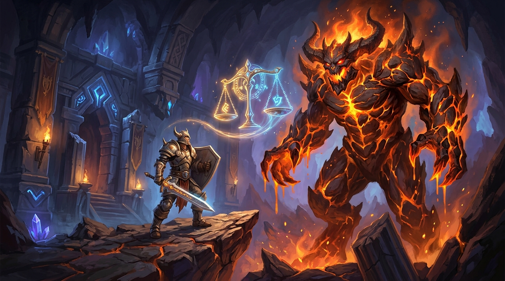

# mod-twow-autobalance for TortoiseWoW / Turtle WoW



Native Vanilla 1.12.1 port of the acclaimed AzerothCore **mod-autobalance** module, adapted for **TortoiseWoW** and **Turtle WoW** (client 1.18.1.7272).

---

## 1. Overview

`mod-twow-autobalance` dynamically adjusts dungeon and raid encounter difficulty based on the number and levels of active players inside an instance. It allows small groups (or even solo players with or without PlayerBots) to experience group content with smoothly scaled health, mana, armor, damage, and crowd-control mechanics while maintaining the intended boss encounter pacing.

### Key Highlights
- **100% Non-Intrusive (The Unediting Doctrine)**: Zero patches to `tortoise-wow` or `TortoiseBots`. All hooks use native virtual script hooks (`UnitScript`, `PlayerScript`, `AllMapScript`).
- **Smooth Hyperbolic Tangent (tanh) Scaling**: Smooth sigmoid curves parameterized by inflection points, floor, ceiling, and boss modifiers (1:1 parity with upstream WotLK).
- **Dynamic & Fixed Level Scaling**: Scales creature levels, health, mana, and damage relative to the highest player level in the party.
- **Multi-Wing Distance Proximity**: Distance-checked creature activation for multi-wing dungeons such as Scarlet Monastery (Map 189).
- **Summons & Clones Hierarchy**: Full boss summon, temporary summon unwrapping, and trigger NPC filtering.
- **Separate Boss Tuning**: Custom modifiers and curves for dungeon bosses vs trash mobs.
- **Combat Locking**: Prevents player count exploits during active boss encounters.
- **Reward Scaling**: Configurable XP and money drop scaling based on effective group size with native money loot hooks.
- **PlayerBots (`TortoiseBots`) Compatibility**: Configurable bot difficulty weighting (`AutoBalance.CountBots`, `AutoBalance.BotWeight`) and automatic suppression of chat sysmessages to headless bot sessions.
- **High-Performance Concurrency**: Reader-writer `std::shared_mutex` for hot combat paths and $O(1)$ amortized lazy timestamp-based creature rescaling.
- **Cross-Platform**: Fully compatible with Linux (Ubuntu 22.04 / 24.04 LTS) and Windows.

---

## 2. Installation

Under **The Unediting Doctrine**, no core modifications or git patches are required.

### 2.1 Clone or Link the Module

Place the module inside the `modules` directory of your TortoiseWoW tree:

```bash
cd /path/to/tortoise-wow/modules
git clone https://github.com/Ildourol/mod-twow-autobalance.git mod-twow-autobalance
```

Your source tree structure:

```text
tortoise-wow/
├── modules/
│   └── mod-twow-autobalance/
│       ├── conf/
│       │   └── mod-twow-autobalance.conf.dist
│       ├── data/
│       │   └── sql/world/
│       ├── src/
│       ├── mod-twow-autobalance.cmake
│       ├── mod-twow-autobalance.jpg
│       └── README.md
```

### 2.2 Configure the Module

Copy the distributed configuration file:

```bash
cp modules/mod-twow-autobalance/conf/mod-twow-autobalance.conf.dist \
   modules/mod-twow-autobalance/conf/mod-twow-autobalance.conf
```

At minimum, enable the module with:

```ini
TwowAutoBalance.Enable = 1
```

(`AutoBalance.Enable.Global = 1` is also accepted as an alias).

### 2.3 Configure and Build TortoiseWoW

**Linux / Ubuntu 22.04 & 24.04 LTS:**

```bash
# Install dependencies
sudo apt update && sudo apt install -y build-essential cmake git libace-dev libmysqlclient-dev libssl-dev libbz2-dev zlib1g-dev

cd /path/to/tortoise-wow
mkdir -p build && cd build
cmake .. -DCMAKE_BUILD_TYPE=Release -DMODULE_MOD_TWOW_AUTOBALANCE=static
cmake --build . --target mangosd -j$(nproc)
```

**Windows (Visual Studio 2022):**

```powershell
cd C:\path\to\tortoise-wow
cmake -S . -B build -G "Visual Studio 17 2022" -A x64 -DMODULE_MOD_TWOW_AUTOBALANCE=static
cmake --build build --config Release --target mangosd --parallel
```

### 2.4 Verify the Installation

After starting `mangosd`, use:

```text
.ab info
```

or:

```text
.autobalance info
```

to verify that `mod-twow-autobalance` is loaded and active.

---

## 3. Mathematical Methodology

### Inflection Point & Sigmoid Multiplier Formula

Let:
- $N_{\text{max}}$ be the maximum intended instance capacity (e.g. 5 for normal dungeons, 10/20/40 for raids).
- $P_{\text{eff}}$ be the adjusted effective player count in the instance.
- $I_f$ be the configured inflection factor (default: 0.5).
- $I = N_{\text{max}} \times I_f$ be the resulting player-count inflection point.
- $F$ be the curve floor (default: 0.0).
- $C$ be the curve ceiling (default: 1.0).

$$\text{diff} = \frac{N_{\text{max}}}{5.0} \times 1.5$$

$$\text{denom} = \left( \frac{\tanh\left(\frac{N_{\text{max}} - I}{\text{diff}}\right) + 1}{2} \right) \times (C - F) + F$$

$$\text{ceilingAdjustment} = \frac{C}{\text{denom}}$$

$$\text{multiplier} = \left( \frac{\tanh\left(\frac{P_{\text{eff}} - I}{\text{diff}}\right) + 1}{2} \right) \times (C \times \text{ceilingAdjustment} - F) + F$$

Each creature stat (Health, Mana, Armor, Damage, CC Duration) is computed from its unmodified base baseline:
- $\text{Health} = \max(1, \text{round}(\text{baseHealth} \times \text{multiplier} \times \text{mod}_{\text{global}} \times \text{mod}_{\text{health}} \times \text{ratio}_{\text{level}}))$
- $\text{Damage} = \text{baseDamage} \times \text{multiplier} \times \text{mod}_{\text{global}} \times \text{mod}_{\text{damage}} \times \text{ratio}_{\text{level}}$

---

## 4. Architecture & Non-Intrusive Hooks

| Component | Role | Hook Technique |
|---|---|---|
| `AutoBalance.h` | Core data models & structs | Shared structs, memory-safe lifetime |
| `AutoBalanceConfig` | Configuration parser | Supports whitespace & legacy colon delimiters, `-1` inheritance |
| `AutoBalanceScaling` | Mathematical scaling engine | Sigmoid inflection, level calculations, summons & distance checks |
| `AutoBalanceManager` | Central state registry | `std::shared_mutex` concurrency, $O(1)$ lazy rescaling |
| `AutoBalanceScripts` | Engine integration | `UnitScript::OnUnitUpdate` (lazy registration), `PlayerScript::OnMoneyChanged`, `AllMapScript` |
| `AutoBalanceCommands` | GM commands | `.ab` / `.autobalance` subcommands |

---

## 5. Chat Commands

All commands can be invoked via `.ab` or `.autobalance`:

- `.ab mapstat` / `.ab map`: Displays diagnostic statistics for the current instance (player counts, min players, combat lock status, level range, active creatures).
- `.ab creaturestat` / `.ab creature`: Displays detailed multiplier and base/scaled stats for the currently targeted creature.
- `.ab getoffset`: Displays the active player-count difficulty offset.
- `.ab setoffset <-N .. +N>`: Adjusts difficulty offset on the fly and rescales live instances (Gamemaster only).
- `.ab reload`: Reloads `mod-twow-autobalance.conf` without restarting the server (Administrator only).
- `.ab info`: Displays module status and active feature toggles.

---

## 6. PlayerBots (`TortoiseBots`) Interoperability

When running with `TortoiseBots`:
- Bots with headless sessions (`session->IsHeadless()`) are recognized automatically.
- Server operators can configure `AutoBalance.CountBots = 1` and `AutoBalance.BotWeight = 1.0` (or fractional values such as `0.8`).
- Headless bot sessions are automatically filtered out from chat announcements, avoiding packet allocation overhead.

---

## 7. License & Credits

- Ported to TortoiseWoW / Turtle WoW by Antigravity (Google DeepMind).
- Original AzerothCore mod-autobalance authors: **VAS**, **CVMagic**, and the **AzerothCore Community**.
- Licensed under the GNU General Public License v2 (GPLv2).
