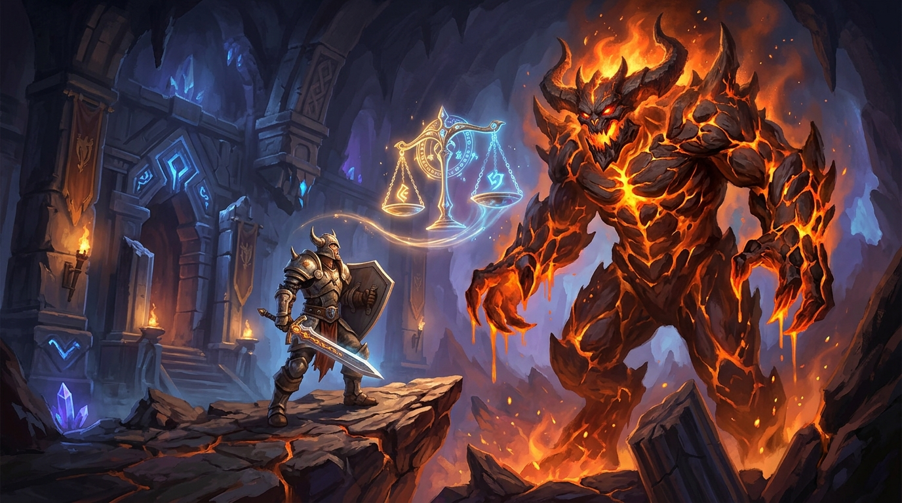

# mod-twow-autobalance for TortoiseWoW / Turtle WoW



Vanilla 1.12.1 port of the AzerothCore **mod-autobalance** module, adapted for **TortoiseWoW** and **Turtle WoW** (client 1.18.1.7272).

---

## 1. Overview

`mod-twow-autobalance` dynamically adjusts dungeon and raid encounter difficulty based on the number and levels of active players inside an instance. It allows small groups (or solo players with or without PlayerBots) to experience group content with smoothly scaled health, mana, armor, damage, and crowd-control mechanics while maintaining the intended encounter pacing.

### Key Highlights
- **Non-Intrusive Integration**: Zero core modifications or source code patches required for `tortoise-wow` or `TortoiseBots`. All hooks use native virtual script hooks (`UnitScript`, `PlayerScript`, `AllMapScript`).
- **Clean Installation & Zero Database Mitigation**: Pure in-memory operational model without database migrations, historical SQL tables, or schema repair.
- **Boot Native Capacity Baseline**: Captures authentic map capacities once at boot before modifying entrance limits; cleanly releases overrides if disabled.
- **Instance State Isolation**: 64-bit packed keys `(mapId << 32) | instanceId` paired with object GUIDs isolate creature state across all dungeon instances.
- **Separate Summons Lifecycle**: Temporary summons are tracked independently to prevent skewing native level averages while fully participating in scaling and cleanup.
- **Smooth Hyperbolic Tangent (tanh) Scaling**: Smooth sigmoid curves parameterized by inflection points, floor, ceiling, and boss modifiers (1:1 parity with upstream WotLK).
- **Dynamic & Fixed Level Scaling**: Scales creature levels, health, mana, and damage relative to the highest player level in the party, supporting native boss curves through level 63.
- **Native Armor Recalculation**: Explicitly invokes `creature->UpdateArmor()` upon applying or restoring base armor modifiers.
- **Combat Safety & Deferred Work**: Protects active encounters with combat locking and safely defers pending rescale/restore operations until combat concludes.
- **Selective Hook Subscriptions**: Registers only implemented hook selectors, ensuring zero overhead on unhandled core events.
- **PlayerBots (`TortoiseBots`) Compatibility**: Configurable bot difficulty weighting (`AutoBalance.CountBots`, `AutoBalance.BotWeight`) and automatic suppression of chat sysmessages to headless bot sessions.

---

## 2. Installation

From the TortoiseWoW source root, clone or copy the module directly into `modules/mod-twow-autobalance/`.

```bash
git clone https://github.com/Ildourol/mod-twow-autobalance.git modules/mod-twow-autobalance
```

**Linux**

```bash
cmake -S . -B build -DCMAKE_BUILD_TYPE=Release -DMODULE_MOD_TWOW_AUTOBALANCE=static
cmake --build build --parallel
```

**Windows** (PowerShell, Visual Studio 2022 with C++ tools)

```powershell
cmake -S . -B build -G "Visual Studio 17 2022" -A x64 -DMODULE_MOD_TWOW_AUTOBALANCE=static
cmake --build build --config Release --parallel
```

Preserve the CMake options for your existing server and modules. Deploy the rebuilt `mangosd` (`mangosd.exe` on Windows). Copy the module’s `conf/mod-twow-autobalance.conf.dist` to `modules/mod-twow-autobalance.conf` beside the active `mangosd.conf` and restart after completing any setup below.

**Database.** This module ships no SQL migrations.

## 3. Mathematical Methodology

### Inflection Point & Sigmoid Multiplier Formula

Let:
- $N_{\text{max}}$ be the maximum intended instance capacity (e.g. 5 for normal dungeons, 10/20/40 for raids).
- $P_{\text{eff}}$ be the adjusted effective player count in the instance.
- $I_f$ be the configured inflection factor (default: 0.5).
- $I = N_{\text{max}} \times I_f$ be the resulting player-count inflection point.
- $F$ be the curve floor.
- $C$ be the curve ceiling (default: 1.0).

$$\text{diff} = \frac{N_{\text{max}}}{5.0} \times 1.5$$

$$\text{denom} = \left( \frac{\tanh\left(\frac{N_{\text{max}} - I}{\text{diff}}\right) + 1}{2} \right) \times (C - F) + F$$

$$\text{ceilingAdjustment} = \frac{C}{\text{denom}}$$

$$\text{multiplier} = \left( \frac{\tanh\left(\frac{P_{\text{eff}} - I}{\text{diff}}\right) + 1}{2} \right) \times (C \times \text{ceilingAdjustment} - F) + F$$

Each creature stat (Health, Mana, Armor, Damage, CC Duration) is computed from its unmodified base baseline:
- $\text{Health} = \max(1, \text{round}(\text{baseHealth} \times \text{multiplier} \times \text{mod}_{\text{global}} \times \text{mod}_{\text{health}} \times \text{ratio}_{\text{level}}))$
- $\text{Damage} = \text{baseDamage} \times \text{multiplier} \times \text{mod}_{\text{global}} \times \text{mod}_{\text{damage}} \times \text{ratio}_{\text{level}}$

---

## 4. Architecture & Non-Intrusive Hooks

| Component | Role | Hook Technique |
|---|---|---|
| `AutoBalance.h` | Core data models & structs | Instance-aware keys `(mapId << 32) | instanceId`, separate summons tracking |
| `AutoBalanceConfig` | Configuration parser | Native `sConfig` reader, whitespace format, structural size guards |
| `AutoBalanceScaling` | Mathematical scaling engine | Sigmoid inflection, immutable built-in Vanilla curves (lvl 1-63), `UpdateArmor()` |
| `AutoBalanceManager` | Central state registry | Instance isolation, boot capacity capture, 5-second maintenance cadence |
| `AutoBalanceScripts` | Engine integration | Filtered `UnitScript`, `PlayerScript`, `AllMapScript`, and `WorldScript` hooks |
| `AutoBalanceCommands` | GM commands | `.ab` / `.autobalance` subcommands |

---

## 5. Chat Commands

All commands can be invoked via `.ab` or `.autobalance`:

- `.ab mapstat` / `.ab map`: Displays diagnostic statistics for the current instance (player counts, min players, combat lock status, level range, active creatures).
- `.ab creaturestat` / `.ab creature`: Displays detailed multiplier and base/scaled stats for the currently targeted creature.
- `.ab getoffset`: Displays the active player-count difficulty offset.
- `.ab setoffset <-N .. +N>`: Adjusts global difficulty offset on the fly and schedules refreshes for all tracked instances (Developer security rank `SEC_DEVELOPER` or console).
- `.ab reload`: Requests native full configuration reload without restarting the server (Administrator rank `SEC_ADMINISTRATOR` or console).
- `.ab info`: Displays module status and active feature toggles.

---

## 6. PlayerBots (`TortoiseBots`) Interoperability

When running with `TortoiseBots`:
- Bots with headless sessions (`session->IsHeadless()`) are recognized automatically.
- Server operators can configure `AutoBalance.CountBots = 1` and `AutoBalance.BotWeight = 1.0` (or fractional values such as `0.8`).
- Headless bot sessions are automatically filtered out from chat announcements, avoiding packet allocation overhead.

---

## 7. Credits

- Based on the original AzerothCore `mod-autobalance` module by **VAS**, **CVMagic**, and the **AzerothCore Community**.
- Adapted for TortoiseWoW / Turtle WoW (Vanilla 1.12.1 / client 1.18.1.7272).
